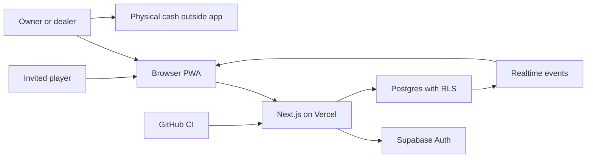

# House Rules threat model

## Executive summary

The highest risks are a compromised dealer account creating false value entries, authorization mistakes exposing household financial history, replay/concurrency corrupting game state, and secret or session leakage. The design reduces these with invite-only authentication, database-enforced club roles, append-only integer accounting, idempotent versioned commands, strict origin checks, RLS, CSP nonces, and audit records. Provider rate limiting and deployed-database policy tests remain production gates.

## Scope and assumptions

- In scope: the Next.js application, Supabase schema/RPCs/RLS, browser clients, CI, and Vercel/Supabase deployment configuration.
- Intended use: invited adults at one private residence, one household club, small no-rake games; the dealer holds and settles physical money outside the app.
- Internet exposure: public HTTPS origin with invite-only authenticated club data; `/demo` contains simulated data only.
- Sensitive data: member identity, attendance, game history, and tracked real-world value. No bank credentials, card data, or payment tokens are permitted.
- Out of scope: money custody or transfer, Cash App/payment verification, public matchmaking, camera judging, AI dealing, and redeemable online play.
- Open production questions: final member count and provider rate-limit thresholds; whether Supabase email delivery uses a custom SMTP provider.

## System model

### Primary components

- Next.js PWA and Route Handlers: public landing/demo, authenticated clubhouse, validated mutation APIs ([`app/`](app), [`app/api/`](app/api)).
- Supabase Auth/Postgres/Realtime: cookie sessions, club membership, RLS, ledger, game commands/events, audit history ([migration](supabase/migrations/202611060001_private_club.sql)).
- Vercel/edge: TLS, request routing, environment injection, and required production rate limits ([`next.config.ts`](next.config.ts), [`proxy.ts`](proxy.ts)).
- Build/CI: locked npm dependencies and verification workflow ([`package-lock.json`](package-lock.json), [CI](.github/workflows/ci.yml)).

### Data flows and trust boundaries

- Browser → Next.js: emails, commands, and ledger requests over HTTPS; Supabase session cookies, strict runtime schemas, size limits, exact-origin validation, and CSP apply.
- Next.js → Supabase Auth: magic-link exchange and session refresh over HTTPS; publishable key plus user-bound cookies, never a service-role key.
- Browser/Next.js → Postgres API: authenticated queries/RPCs; RLS and `security definer` functions with fixed search paths enforce membership and roles.
- Dealer → physical settlement: outside the system; the app records assertions only and cannot verify cash movements.
- GitHub CI → build artifacts: locked dependencies, read-only repository permission, lint/type/unit/build gates; deployment credentials are out of repository scope.

#### Diagram

## Assets and security objectives

| Asset | Why it matters | Security objective (C/I/A) |
|---|---|---|
| Ledger and balances | Incorrect entries cause real disputes | I, A |
| Roles and memberships | Dealer privilege controls financial/game mutations | C, I |
| Auth cookies and magic links | Theft enables account takeover | C, I |
| Game commands/events and hidden cards | Tampering or disclosure breaks fairness | C, I, A |
| Audit history | Required to investigate corrections and abuse | I, A |
| Provider credentials/config | Compromise exposes the entire club | C, I, A |

## Attacker model

### Capabilities

- An unauthenticated internet user can reach public pages, sign-in, callback, and Route Handlers.
- An invited player can modify client requests, replay commands, guess UUIDs, race actions, and inspect all browser-delivered code.
- A malicious or compromised dealer account can attempt unauthorized corrections or false game events.
- A local device user or browser extension can inspect that device’s rendered data.

### Non-capabilities

- Attackers do not initially control Vercel, Supabase, DNS, owner email, or repository administration.
- The system contains no payment credentials, bank access, cash custody, arbitrary uploads, URL fetching, subprocess execution, or camera input.
- Practice chips have no redemption path and are separated from real-value entries by database constraints.

## Entry points and attack surfaces

| Surface | How reached | Trust boundary | Notes | Evidence |
|---|---|---|---|---|
| Magic-link form/callback | Public HTTPS | Internet → Auth | No public user creation; exact callback origin | `app/sign-in/actions.ts`, `app/auth/callback/route.ts` |
| Ledger API | Authenticated POST | Browser → Next.js → DB | Role, origin, schema, size, RPC, RLS | `app/api/ledger/route.ts` |
| Game command API | Authenticated POST | Browser → Next.js → DB | Idempotent UUID and expected version | `app/api/game/command/route.ts` |
| Supabase tables/RPCs | Publishable API | Client/server → Postgres | RLS on every exposed table; fixed search paths | `supabase/migrations/202611060001_private_club.sql` |
| Demo route | Public HTTPS | Internet → browser | Fixtures and local state only; visibly nonfinancial | `app/demo/page.tsx`, `components/club-cockpit.tsx` |
| Build/deploy | Git push/CI | Developer → supply chain | Lockfile and read-only CI token | `.github/workflows/ci.yml` |

## Top abuse paths

1. Attacker requests magic links for arbitrary addresses → Auth would create accounts → prevented by `shouldCreateUser: false`; only pre-created invitees proceed.
2. Player alters a request to append a buy-in → API and RPC check owner/dealer role → write is rejected and direct table inserts lack an RLS policy.
3. Dealer tries to edit or delete an embarrassing entry → immutable trigger rejects it → a linked opposite correction is required.
4. Client converts practice chips into tracked cash → enum/event constraints and namespace-specific RPC validation reject cross-namespace conversion.
5. Two clients act on one game version → row lock and expected-version comparison accept one → stale command is preserved as rejected.
6. Cross-site page submits a ledger mutation with cookies → exact `Origin`, JSON content type, and SameSite session posture reject it.
7. XSS payload is stored in a display name or note → React escapes strings, no raw HTML sinks exist, and nonce CSP limits executable scripts.
8. Stolen dealer session submits valid-looking entries → database permits the dealer role → audit logs support detection; MFA/session policy is a residual operational control.

## Threat model table

| Threat ID | Threat source | Prerequisites | Threat action | Impact | Impacted assets | Existing controls (evidence) | Gaps | Recommended mitigations | Detection ideas | Likelihood | Impact severity | Priority |
|---|---|---|---|---|---|---|---|---|---|---|---|---|
| TM-001 | Invited player | Valid player session | Forge dealer ledger RPC/request | False balances | Ledger, audit | API role check; RPC role check; no insert policy (`app/api/ledger/route.ts`, migration) | Provider policy not yet applied/tested | Apply migration; run role-based pgTAP tests | Alert on forbidden RPC errors | medium | high | high |
| TM-002 | Compromised dealer | Dealer session theft | Append plausible false entries or corrections | Financial dispute | Ledger, memberships | Append-only entries and audit actor IDs (migration) | MFA and anomaly alerts not configured | Require owner MFA; notify owner on corrections/large entries | Daily correction and threshold report | medium | high | high |
| TM-003 | Authenticated client | Ability to race/replay | Replay or submit stale commands | Game integrity loss | Commands/events | Command UUID idempotency, row lock, state version (migration) | Full per-game rule reducers are not networked yet | Process each game action through a deterministic server reducer | Version-conflict rate | medium | medium | medium |
| TM-004 | Internet attacker | Public origin | CSRF or oversized mutation spam | Unauthorized action/DoS | Availability, ledger | Same-origin check, JSON-only, body limit, cookie protections (`lib/server/request-security.ts`) | Distributed rate limiting is provider-dependent | Add Vercel/Supabase rate limits by IP/user | 403/413/429 dashboards | medium | medium | medium |
| TM-005 | Auth/RLS mistake | Bad migration or future policy edit | Read another member’s/private card data | Privacy/fairness loss | Member and hidden game data | Explicit RLS and private payload separation (migration) | Database tests not runnable here | Add pgTAP matrix for anonymous/player/dealer/owner; expose private cards only via seat-specific RPC | Log denied table access | low | high | medium |
| TM-006 | Supply-chain attacker | Vulnerable dependency/repo access | Execute code in build/runtime | Full compromise | All assets | Lockfile, CI, zero production audit findings | Moderate dev-only advisories remain | Dependabot; patch supported Next releases promptly | GitHub dependency alerts | low | high | medium |
| TM-007 | XSS attacker | Future unsafe render or third-party script | Steal session or act as user | Account compromise | Sessions, ledger | React escaping, no HTML sinks, nonce CSP, no third-party scripts (`proxy.ts`) | Runtime CSP needs deployed verification | Browser security-header test in preview/production | CSP reports and auth anomalies | low | high | medium |
| TM-008 | Curious public user | Access to `/demo` | Mistake simulated state for real records | Trust/confusion harm | Product integrity | Persistent demo ribbon and no backend writes (`components/club-cockpit.tsx`) | Demo fixtures resemble people | Keep fictional identities and never load club data in demo | Route-level data-access tests | low | low | low |

## Criticality calibration

- Critical: unauthenticated ledger mutation, service-role key exposure, or cross-club/full-database compromise.
- High: player-to-dealer privilege escalation, hidden-card disclosure affecting live play, or silent ledger history modification.
- Medium: bounded action replay, targeted availability loss, missing distributed throttling, or member-only metadata exposure.
- Low: public demo confusion, non-sensitive header disclosure, or noisy failures with no integrity effect.

## Focus paths for security review

| Path | Why it matters | Related Threat IDs |
|---|---|---|
| `supabase/migrations/202611060001_private_club.sql` | RLS, immutable ledger, privileged RPCs, and game concurrency | TM-001, TM-002, TM-003, TM-005 |
| `lib/server/auth.ts` | Central session and role enforcement | TM-001, TM-002 |
| `lib/server/request-security.ts` | CSRF/origin and error boundary | TM-004 |
| `app/api/ledger/route.ts` | Real-value mutation entry point | TM-001, TM-002, TM-004 |
| `app/api/game/command/route.ts` | Authoritative command entry point | TM-003, TM-004 |
| `proxy.ts` | Session refresh and nonce CSP | TM-007 |
| `components/club-cockpit.tsx` | Largest user-input/render surface | TM-007, TM-008 |
| `.github/workflows/ci.yml` | Dependency and build supply chain | TM-006 |

## Notes on use

- Covered every discovered runtime entry point and each browser/server/database trust boundary.
- Kept CI/build risks separate from runtime behavior.
- Reflected the confirmed one-household, one-visible-club context and no-rake/no-custody boundary.
- Revisit this model before adding networked multiplayer reducers, payments, external links, uploads, camera access, or AI providers.
